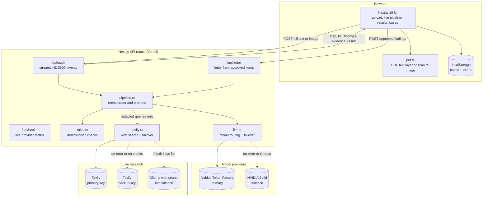

<div align="center">
<br/>


# Quibillix

**Quibillix: AI-Powered Bill Verification and Dispute Agent**

**Live:** _coming soon (deploying to Vercel)_

[](https://github.com/mdharishsuhaib/Quibillix/stargazers) [](https://github.com/mdharishsuhaib/Quibillix/network/members)

[](https://nextjs.org/) [](https://react.dev/) [](https://www.typescriptlang.org/) [](https://tailwindcss.com/) [](https://build.nvidia.com/) [](https://tokenfactory.nebius.com/) [](https://tavily.com/) [](https://ollama.com/) [](https://vercel.com/) [](./LICENSE)

</div>

---

## About the Project

*Quibble + bill + x: every charge questioned, every dispute supported.*

Quibillix is an AI-powered bill verification and dispute agent for anyone who has been handed
a bill they cannot check: **patients and families** facing medical or hospital bills full of
codes such as `99285` and `0450`, and **households and small businesses** paying telecom,
utility and B2B invoices.

It reads a bill the way a professional billing advocate would. It re-checks the math, prices
each charge against live benchmarks and consumer law, separates proven errors from suspicions,
and drafts an evidence-backed dispute letter. Nothing is sent until you approve each item, and
you can track the case through to the money you actually recover.

---

## Table of Contents

- [Overview](#overview)
- [Key Features](#key-features)
- [System Architecture](#system-architecture)
- [How the Scoring Works](#how-the-scoring-works)
- [Repository Structure](#repository-structure)
- [Prerequisites](#prerequisites)
- [Quick Start](#quick-start)
- [Backend Setup](#backend-setup)
- [Frontend Setup](#frontend-setup)
- [API Reference](#api-reference)
- [Database Schema](#database-schema)
- [Security and Privacy Model](#security-and-privacy-model)
- [Operational Limits and Constraints](#operational-limits-and-constraints)
- [Deployment](#deployment)
- [Running Tests](#running-tests)
- [Troubleshooting](#troubleshooting)
- [Learning Guide](#learning-guide)
- [Tech Stack](#tech-stack)

---

## Overview

1. A user opens the app. There is **no account and no sign-up**.
2. They **upload a bill** (PDF, photo, TXT, CSV or MD) or **paste the text**, and can add a
   short note such as "I was only in the ER for an hour" or "the plan was quoted at $45".
   Digital PDFs are read in the browser; scanned PDFs and photos are downscaled in the browser
   and sent as one image.
3. **Read the bill:** NVIDIA Nemotron turns it into structured line items (Nemotron 3.5 Super
   VL for images, fast Nemotron for text).
4. **Hard checks:** deterministic TypeScript code re-checks quantity x price, duplicates,
   subtotal and total due, day counts against the stay or billing period, tax on exempt
   healthcare, and junk fees. Only these checks can mark an error as **confirmed**.
5. **Plan research:** Nemotron Super picks the 3 to 4 charges most likely to be wrong and writes
   a search query for each. Personal identifiers are stripped from the queries.
6. **Live research:** **Tavily** fetches fee schedules, rate caps and consumer law. If the first
   Tavily key fails or runs out of credits, the same query tries the **second Tavily key**, then
   **Ollama web search**, automatically.
7. **Deep audit:** **Nemotron 3 Ultra** looks for upcoding, unbundling, price outliers, balance
   billing and services never received. Every claim must cite a retrieved source.
8. **Write the dispute:** Nemotron Super drafts a dispute letter and a phone script, one
   paragraph per item, worded by certainty.
9. **Resolve with oversight:** the user **approves or rejects each finding**, the letter is
   rewritten for exactly what they approved, and the case is tracked (Draft, Sent, Responded,
   Resolved) with the amount actually recovered and a timestamped audit trail.

The whole run streams live to the screen, step by step, in about **42 seconds** on average.

---

## Key Features

- **Six-step agent pipeline** -- Read, Hard checks, Plan research, Live research, Deep audit
  and Write dispute, each streamed live with the model that answered it.
- **Confirmed, suspected and needs info, never mixed up** -- Arithmetic that is provable from
  the bill is *confirmed*. Benchmark-backed claims are *suspected*. Missing records become a
  *request*, with no money claimed.
- **The model proposes, code decides** -- A price claim keeps its amount only if it cites a
  retrieved source **and** is at least 3x the benchmark or breaks a legal ceiling (MRP, NPPA,
  regulated cap). Weaker claims are downgraded to "needs info".
- **The user's word wins** -- If you say a price was quoted, contracted or matches the MRP,
  benchmark-based price claims on it are dropped.
- **No double counting** -- Overlapping findings are capped per line, so totals never exceed
  what was billed.
- **Real citations only** -- The audit can only cite URLs that research actually returned; the
  model cannot invent sources.
- **Human approval per finding** -- Toggle each item on or off, then the letter is rewritten
  (`/api/letter`) from approved items only. You can edit it, copy it or download it.
- **Case tracker and value dashboard** -- Flagged, confirmed, in dispute, recovered and review
  time saved, with a full agent-and-human audit trail. Stored only in your browser.
- **Built to stay up** -- Nebius Token Factory first, NVIDIA Build as automatic backup, per-tier
  timeouts, retries and tier fallback; Tavily key 1, then Tavily key 2, then Ollama web search.
- **Polished, accessible UI** -- Light mode by default (Payne's Grey on Vellum) with a dark mode
  toggle, an interactive 3D bill journey in the hero, `Ctrl + Enter` (or `⌘ + Enter`) to jump to
  the bill box or run the audit, and motion that respects reduced-motion settings.
- **Works in many countries** -- US, UK and India medical and hospital bills, utility, telecom
  and B2B invoices, in any currency.

---

## System Architecture



- **Frontend** -- Next.js 16 (App Router) + React 19 + TypeScript + Tailwind CSS 4. PDFs are
  parsed in the browser with `pdfjs-dist`, and photos are downscaled before upload.
- **Backend** -- Next.js API routes on Node. `/api/audit` streams newline-delimited JSON
  (NDJSON) so the UI shows each step as it finishes.
- **Models** -- Every step goes to the cheapest Nemotron model that does it well, through one
  OpenAI-compatible endpoint. If Nebius Token Factory fails, the same call goes to NVIDIA Build.
- **No database** -- Bills are processed in memory. Cases live in the user's browser only.

---

## How the Scoring Works

### Certainty levels

| Certainty | What it means | Who can assign it | Money claimed |
|---|---|---|---|
| **Confirmed error** | Provable from the bill's own numbers | Deterministic code only (`rules.ts`) | Yes |
| **Suspected overcharge** | Backed by a cited benchmark, rule or the user's own account; the provider must justify or reduce it | AI audit, after the price gate | Yes |
| **Needs info** | Cannot be judged without itemization or records | AI audit, or a downgraded weak claim | No |

### Deterministic checks (`src/lib/rules.ts`)

| # | Check | What it catches |
|---|---|---|
| 1 | Line math | Quantity x unit price does not equal the line amount |
| 2 | Duplicates | Same code or description, same date, same amount |
| 3 | Subtotal | Stated subtotal is higher than the sum of the line items |
| 4 | Total due | Balance does not reconcile with subtotal minus adjustments and payments |
| 5 | Discretionary fees | Late-payment, penalty, admin, convenience and paper-bill fees that are often waived |
| 6 | Stay days | Per-day charges billed for more days than the inpatient stay (discharge day excluded) |
| 7 | Billing-period days | Standing charges or daily rentals billed for more days than the period |
| 8 | Tax on healthcare | GST or sales tax on exempt clinical services (India: non-ICU rooms above ₹5,000/day are the exception) |

### Model routing

| Step | Tier | Nebius Token Factory model | Why this model |
|---|---|---|---|
| Bill photo to JSON | vision | `nvidia/Nemotron-3.5-Super-VL` | Reads document images, tables and small print |
| Bill text to JSON | fast | `nvidia/NVIDIA-Nemotron-3-Nano-30B-A3B` | Fast and cheap for structured extraction |
| Research plan, letter, phone script | mid | `nvidia/nemotron-3-super-120b-a12b` | Good writing and planning at mid cost |
| Deep audit | deep | `nvidia/Nemotron-3-Ultra-550b-a55b` | Multi-step reasoning over codes, law and evidence |

A full audit is about 5 model calls, and most tokens go through Nano or Super. If a whole tier
fails, the step drops to the next one (Ultra to Super, Nano to Super). The NVIDIA Build fallback
uses the matching `NVIDIA_MODEL_*` IDs from `.env.example`.

### Measured accuracy (21-bill benchmark)
`npm run eval` runs a labelled benchmark of **21 bills** (`eval/cases.ts`, `eval/cases-more.ts`)
across US, UK and India: medical, hospital, utility, telecom and B2B invoices. It has **25 planted
errors** and **5 clean control bills** that must come back clean. A planted error only counts if a
money-bearing finding sits on the right line with an accepted issue type. Results are written to
`eval/results.json`.

| Metric | Result (latest run: 21 bills, NVIDIA Build endpoint) |
|---|---|
| Planted errors caught (recall) | **24 / 25 (96%)** |
| Precision on labelled lines | **27 / 29 (93%)** |
| Clean control bills | **5 / 5 came back clean** |
| False positives on known-legit lines | 2 (both "possibly bundled" supply items) |
| Arithmetic correctness (claimed vs true amount) | **6 / 6 (100%)** |
| Citations that are real retrieved URLs | **57 / 57 (100%)** |
| AI findings with at least one citation | 16 / 18 (89%) |
| Dispute letters covering every disputed item | **16 / 16 (100%)** |
| Pipeline errors | 0 |
| Time | avg **42 s**, median 38 s per bill (15 min total vs about **15 h** by hand) |

The one miss: on a utility bill with an *estimated* meter reading, Quibillix flagged the fees but
did not recompute usage from the actual reading the user supplied.

On the three bundled samples (US ER visit, Indian hospital stay, mobile and broadband bill) it
catches the duplicate X-ray, an upcoded ER level, No Surprises Act balance billing, an ICU charge
with no ICU stay, extra room-days, GST on exempt healthcare, cramming add-ons and junk fees.

---

## Repository Structure

```text
Quibillix/
├── src/
│   ├── app/
│   │   ├── layout.tsx           # Fonts, metadata, theme boot script (no flash on load)
│   │   ├── page.tsx             # Landing hero, 3D journey, proof figures, workspace
│   │   ├── globals.css          # Light and dark theme tokens, animations
│   │   ├── icon.png, apple-icon.png, favicon.ico
│   │   └── api/
│   │       ├── audit/route.ts   # POST: run the audit, streams NDJSON; GET: provider chain
│   │       ├── letter/route.ts  # POST: rewrite the letter from approved findings
│   │       └── health/route.ts  # GET: live status of every provider and search engine
│   ├── components/
│   │   ├── AuditApp.tsx         # Upload, paste, samples, run, results and cases tabs
│   │   ├── Pipeline.tsx         # Live six-step progress
│   │   ├── Receipt.tsx          # The bill as a till receipt with highlighted lines
│   │   ├── Results.tsx          # Findings, approve switches, letter and phone script
│   │   ├── Verdict.tsx          # Summary totals by certainty
│   │   ├── Cases.tsx            # Case tracker, value dashboard, audit trail
│   │   ├── ThemeToggle.tsx      # Light / dark switch
│   │   └── fx/                  # BillJourney3D, CountUp, Icon, ShortcutKeys
│   └── lib/
│       ├── pipeline.ts          # Orchestrator, prompts, query redaction, price gate
│       ├── llm.ts               # Nemotron client, tier routing, provider failover
│       ├── rules.ts             # Deterministic checks
│       ├── tavily.ts            # Search chain: Tavily key 1, Tavily key 2, Ollama web search
│       ├── pdf.ts               # In-browser PDF reading (text layer or scan)
│       ├── cases.ts             # Case tracker storage (localStorage)
│       ├── samples.ts           # The three bundled sample bills
│       └── types.ts             # Shared types and stream events
├── public/
│   ├── logo.png, logo-icon.png  # Full logo and app icon
│   ├── pdf.worker.min.mjs       # PDF.js worker (required for PDF upload)
│   └── samples/                 # india-hospital-bill.png, utility-bill.pdf
├── eval/                        # 21-bill benchmark: cases, runner, results.json
├── scripts/
│   ├── unit.ts, test-redact.ts  # Offline unit tests (npm test)
│   ├── smoke.mjs                # End-to-end test against a running server
│   ├── e2e.ts                   # Full pipeline from the command line
│   ├── failover-test.ts         # Simulates Nebius failures
│   ├── check-models.mjs         # Verifies model IDs on each provider
│   ├── check-secrets.mjs        # Blocks commits that contain API keys
│   ├── make-icons.py            # Builds the app icons from Logo.png
│   └── make-sample-pdf.py       # Builds public/samples/utility-bill.pdf
├── .githooks/pre-commit         # Runs check-secrets before every commit
├── .env.example                 # Every setting documented (no values)
├── Logo.png                     # Source logo
├── DESIGN.md                    # Colour, type and motion system
├── LICENSE                      # MIT
└── README.md
```

---

## Prerequisites

- **Node.js 20.9+** and `npm` (tested on Node 22).
- At least one NVIDIA Nemotron key: [Nebius Token Factory](https://tokenfactory.nebius.com)
  (primary) and/or [NVIDIA Build](https://build.nvidia.com) (fallback). Using both gives
  automatic failover.
- Recommended: a [Tavily](https://app.tavily.com) key for live research, and an
  [Ollama](https://ollama.com/settings/keys) key as the research fallback. Without either, the
  audit still runs and price findings are marked lower confidence.
- Optional: Python 3, only to rebuild the icons (Pillow, NumPy, SciPy) or the sample PDF
  (reportlab).

---

## Quick Start

One process, one terminal (Windows cmd shown).

```bat
cd /d C:\path\to\Quibillix
npm install
copy .env.example .env.local
:: Open .env.local and fill in NEBIUS_API_KEY and/or NVIDIA_API_KEY, TAVILY_API_KEY, OLLAMA_API_KEY
npm run check-models
npm run dev
```

Open:

- App: `http://localhost:3000`
- Live status: `http://localhost:3000/api/health`
- Provider chain and model routing: `http://localhost:3000/api/audit`

Click a sample bill (US emergency room visit, India private hospital, mobile and broadband
bill, or the hospital photo or utility PDF), then **Check my bill**. Press `Ctrl + Enter` to jump
to the bill box, or to run the audit once a bill is loaded.

`npm install` also turns on the pre-commit secret check (`.githooks/pre-commit`). On macOS or
Linux, use `cp` instead of `copy`.

---

## Backend Setup

The backend is the Next.js API routes in `src/app/api/` (`/api/audit`, `/api/letter`,
`/api/health`). They run in the same process as the UI, so there is no separate server to
start.

**Model and search keys.** Add to `.env.local` in the project root (git-ignored; every setting
is described in `.env.example`):

```env
# Main AI: NVIDIA Nemotron on Nebius Token Factory
NEBIUS_API_KEY=your-key-here
# Backup, used automatically when Nebius is missing, slow or erroring
NVIDIA_API_KEY=your-key-here
# Live research, with Ollama web search as the automatic backup
TAVILY_API_KEY=your-key-here
OLLAMA_API_KEY=your-key-here
RATE_LIMIT_PER_HOUR=20
```

**All settings:**

| Variable | Required | Purpose |
|---|---|---|
| `NEBIUS_API_KEY` | One of the two | Nebius Token Factory key (primary provider) |
| `NEBIUS_BASE_URL` | No | Defaults to `https://api.tokenfactory.nebius.com/v1` |
| `MODEL_VISION`, `MODEL_FAST`, `MODEL_MID`, `MODEL_DEEP` | No | Nemotron model ID per tier on Token Factory |
| `NVIDIA_API_KEY` | One of the two | NVIDIA Build key (automatic fallback) |
| `NVIDIA_BASE_URL` | No | Defaults to `https://integrate.api.nvidia.com/v1` |
| `NVIDIA_MODEL_VISION`, `_FAST`, `_MID`, `_DEEP` | No | Nemotron model ID per tier on NVIDIA Build |
| `TAVILY_API_KEY` | Recommended | Live fair-price and consumer-law research |
| `TAVILY_API_KEY_2` | No | Second Tavily key, tried when the first fails or runs out of credits |
| `OLLAMA_API_KEY` | Recommended | Last research fallback, when every Tavily key has failed |
| `RATE_LIMIT_PER_HOUR` | No | Audits per visitor IP per hour (default `20`) |
| `THINK_TIERS` | No | Turn on Nemotron reasoning mode per tier, for example `deep` |
| `LLM_TIMEOUT_<TIER>_MS` | No | Per-attempt timeout before retry and failover |
| `TAVILY_TIMEOUT_MS`, `OLLAMA_TIMEOUT_MS` | No | Search timeouts (default 25 s each) |

Check that every model ID exists on its provider:

```bat
npm run check-models
```

If a model shows as `MISSING`, copy the matching ID from the output into `.env.local`. Restart
the server after any change to `.env.local`; it is read only at start-up.

---

## Frontend Setup

```bat
npm install
npm run dev
```

Open `http://localhost:3000`. The UI calls the API routes on the same address, so there is no
backend URL or CORS to configure. For a production build, run `npm run build`, then
`npm start`.

PDF reading uses `public/pdf.worker.min.mjs`, which must stay in `public/`. The theme (light by
default) is set before the first paint by a small script in `src/app/layout.tsx`, so the page
never flashes the wrong colours.

---

## API Reference

Base URL: `http://localhost:3000` (local). No authentication; audits are rate limited per IP.

### `POST /api/audit`

Runs the full pipeline and streams one JSON event per line (`application/x-ndjson`).

```json
{ "text": "bill text (or omit and send imageDataUrl)", "imageDataUrl": "data:image/jpeg;base64,...", "context": "optional note from the user" }
```

| Event `type` | Payload |
|---|---|
| `step` | `step` (`extract`, `rules`, `triage`, `research`, `audit`, `letter`), `status` (`running`, `done`, `skipped`, `error`), `model`, `detail`, `ms` |
| `bill` | The parsed bill: line items, dates, currency, stated totals |
| `findings` | Findings so far, each with `certainty`, `estimatedOvercharge` and `citations` |
| `evidence` | Research results per query |
| `result` | Final result: totals by certainty, summary, letter, phone script, models used, duration |
| `error` | A message, if the run failed |

### `GET /api/audit`

The configured provider chain, model IDs per tier, and whether Tavily and Ollama keys are set.

### `POST /api/letter`

Rewrites the dispute letter from only the findings the user approved.

```json
{ "bill": { "...": "parsed bill" }, "findings": [ "approved findings" ], "total": 652, "context": "optional" }
```

Returns `{ "letter": "...", "phoneScript": "..." }`.

### `GET /api/health`

Pings every model provider (1 token on the smallest model), Tavily and Ollama. Cached for 60 s;
add `?fresh` to bypass the cache.

```json
{ "status": "ok", "primary": "Nebius Token Factory", "checkedAt": "2026-10-29T17:42:41.000Z", "checks": [ { "name": "Tavily search", "ok": true, "ms": 412 } ] }
```

`status` is `ok` (everything up), `degraded` (a provider or both search engines down) or `down`
(no model provider up, HTTP `503`).

**Example:**

```bash
curl -N -X POST http://localhost:3000/api/audit -H "Content-Type: application/json" -d "{\"text\":\"ER visit 99285 x1 2400.00\nX-ray 71046 x1 612.00\nX-ray 71046 x1 612.00\"}"
```

---

## Database Schema

Quibillix has **no server database and no accounts**. Nothing about a bill is saved on the
server. The only persistent data is in the user's own browser (`localStorage`), so each person
sees only their own cases.

| Store | Purpose and key fields |
|---|---|
| `quibillix.cases.v1` | Up to 50 dispute cases: `id` (`QB-...`), `createdAt`, `provider`, `currency`, `totalBilled`, `confirmedTotal`, `suspectedTotal`, `approvedTotal`, `approvedIds`, `status` (`draft`, `sent`, `responded`, `resolved`), `recovered`, `durationMs`, `findingsCount`, `result` (full audit), `letter`, `trail` |
| `trail[]` (inside each case) | Audit trail events: `at` (ISO timestamp), `actor` (`agent` or `user`), `action`, `detail` |
| `quibillix-theme` | `light` (default) or `dark` |
| Server memory (not persisted) | Rate limiter: request timestamps per visitor IP for the last hour, reset on restart |

Every agent step and every human decision (approve, reject, status change, amount recovered) is
added to the case's audit trail. Deleting a case removes it and its trail; clearing your
browser's site data deletes all cases.

---

## Security and Privacy Model

- **Bills are processed in memory.** They are sent only to the model provider (Nebius Token
  Factory, or NVIDIA Build on failover) and never written to disk.
- **PDFs are read in your browser.** Digital PDFs never leave the device as files; only their
  extracted text is sent when you click **Check my bill**.
- **Search engines never see the bill.** Tavily and Ollama receive only the generated search
  queries, after `redactQuery` removes names, account, member, policy, claim and UHID numbers,
  emails, phone numbers and long numeric IDs. Billing codes and years are kept.
- **No invented sources.** The audit may only cite URLs that research actually returned.
- **Human in the loop.** Nothing is disputed until you approve each finding; the letter is
  rebuilt from approved items only.
- **Input validation.** Text is capped at 20,000 characters, the note at 2,000, the letter
  request at 40 findings, and images must be `data:image/` URLs.
- **Rate limiting per visitor** -- `RATE_LIMIT_PER_HOUR` audits per IP (HTTP `429` beyond that),
  so a public demo cannot drain API credits.
- **Secrets stay out of git** -- API keys live only in `.env.local` locally and in the Vercel
  environment settings. `.gitignore` excludes every `.env` variant, keys, certificates,
  credentials and CLI token folders. `npm run check-secrets` scans every committable file for
  key patterns and for the real values in `.env.local`, and the pre-commit hook blocks any
  commit that fails it.

---

## Operational Limits and Constraints

| Constraint | Value | Where |
|---|---|---|
| Bill text | 20,000 characters | `src/app/api/audit/route.ts` |
| User note (context) | 2,000 characters | `src/app/api/audit/route.ts` |
| Photo size sent | Longest side 1,800 px, JPEG 85% | `src/components/AuditApp.tsx` |
| PDF pages read | 4 (text), 2 (scanned, rendered as one image) | `src/lib/pdf.ts` |
| Audits per IP | 20 per hour (configurable) | `RATE_LIMIT_PER_HOUR` |
| Audit request duration | 300 s max | `maxDuration` in `/api/audit` and `/api/letter` |
| Model timeouts | fast 60 s, mid 90 s, vision 90 s, deep 120 s | `LLM_TIMEOUT_<TIER>_MS` |
| Retries per model call | 1 (on 429, 5xx, timeout or network error) | `src/lib/llm.ts` |
| Search timeout | 25 s per query | `TAVILY_TIMEOUT_MS`, `OLLAMA_TIMEOUT_MS` |
| Research queries per audit | 3 to 4 | `src/lib/pipeline.ts` |
| Results per search query | 4 | `src/lib/tavily.ts` |
| Findings per letter rewrite | 40 | `src/app/api/letter/route.ts` |
| Stored cases | 50 most recent | `src/lib/cases.ts` |
| Health check cache | 60 s | `src/app/api/health/route.ts` |
| Manual baseline for time saved | 4 min per line | `src/components/Cases.tsx` |

---

## Deployment

**Live setup:** the whole app (UI and API routes) runs as one project on **Vercel**. There is
no separate backend or database to deploy.

### Vercel

1. Push this repository to GitHub, then sign in at [vercel.com](https://vercel.com) with GitHub.
2. **Add New > Project**, pick the repository. Vercel detects Next.js; keep the default build
   (`next build`) and output settings.
3. Under **Settings > Environment Variables**, add `NEBIUS_API_KEY`, `NVIDIA_API_KEY`,
   `TAVILY_API_KEY` and `OLLAMA_API_KEY`, plus any `MODEL_*` / `NVIDIA_MODEL_*` overrides from
   `.env.example`.
4. Deploy. `/api/audit` streams NDJSON and sets `maxDuration = 300`.
5. Check `https://<your-app>.vercel.app/api/health`; it should return `"status":"ok"`.
6. Run `npm run smoke -- https://<your-app>.vercel.app`, then add the `/api/health` URL to a free
   uptime monitor (for example UptimeRobot, every 5 minutes).

The project redeploys automatically on every push to the main branch.

### Other options

- **Any Node host** -- `npm run build` then `npm start` (port 3000, or set `PORT`).
- **Nebius Serverless Endpoints** -- it is a single stateless Node service, so it can run
  there unchanged.
- **Instant public link** -- `cloudflared tunnel --url http://localhost:3000` shares your local
  copy (works only while your computer is running).

---

## Running Tests

```bat
npm test
npm run lint
npm run check-secrets
```

With a server running (`npm run dev`) and API keys set:

```bat
npm run smoke
npm run eval
npm run e2e -- us-er
npm run failover-test
npm run check-models
```

| Command | Covers | Needs keys |
|---|---|---|
| `npm test` | Rules engine, totals capping, price gate (`scripts/unit.ts`) and the search privacy redactor (`scripts/test-redact.ts`) | No |
| `npm run lint` | ESLint (Next.js config) | No |
| `npm run check-secrets` | No API key or real secret value in any committable file | No |
| `npm run smoke [url]` | Health, every sample bill, the photo (vision) path and the approved-letter rewrite against a running server | Yes |
| `npm run eval` | The 21-bill accuracy benchmark; writes `eval/results.json` | Yes |
| `npm run e2e -- <id or path>` | Full pipeline from the command line (`us-er`, `in-hospital`, `telecom` or an image path) | Yes |
| `npm run failover-test` | Nebius returning 401, unreachable and hanging; all answered by NVIDIA Build | Yes |
| `npm run check-models` | Every configured model ID exists on its provider | Yes |

---

## Troubleshooting

### "Server has no model provider configured"

Neither `NEBIUS_API_KEY` nor `NVIDIA_API_KEY` is set. Add at least one to `.env.local` (or to the
Vercel environment variables) and restart `npm run dev`. Environment changes are read only when
the server starts.

### A model shows as `MISSING` in `npm run check-models`

That provider uses a different ID for the model. Copy the matching ID from the command's output
into `.env.local`, for example `MODEL_DEEP=...` or `NVIDIA_MODEL_DEEP=...`.

### Live research says Tavily failed (HTTP 432 or 429)

A Tavily key is out of credits or rate limited. Each query automatically tries
`TAVILY_API_KEY_2`, then Ollama web search (`OLLAMA_API_KEY`), and the audit continues; the step
shows which engine answered, including "(used backup Tavily key)". A key that runs out of credits
is skipped for 10 minutes. `/api/health` shows each key's status separately. Without any search
key, price findings are marked lower confidence.

### `/api/health` returns `degraded`

One model provider is down, or both search engines are. Audits still run on whatever is up.
Open `/api/health?fresh` to re-check now instead of waiting for the 60 s cache.

### "Rate limit reached, please try again in a bit"

More than `RATE_LIMIT_PER_HOUR` audits came from one IP in the last hour. Raise the limit in
`.env.local`, or wait. The counter resets when the server restarts.

### Uploading a PDF fails or shows an empty bill

The PDF.js worker could not load, or the PDF is password protected. Make sure
`public/pdf.worker.min.mjs` exists. For a protected or unusual PDF, upload a screenshot instead.

### The audit stops before the letter

The letter step failed (the model was busy), but the findings are kept. Click **Write the
letter** to try again. If you change which findings are approved, click **Rewrite to match**.

### Port 3000 already in use (Windows)

```bat
for /f "tokens=5" %a in ('netstat -ano ^| findstr :3000 ^| findstr LISTENING') do taskkill /PID %a /F
```

Or start on another port: `npx next dev -p 3100`.

### A commit is blocked by "a secret would be committed"

The pre-commit hook found an API key in a staged or committable file. Move it into `.env.local`
(git-ignored), then commit again. Run `npm run check-secrets` to see the file and the key name.

### Other common issues

| Problem | Fix |
|---|---|
| My cases disappeared | Cases are stored in this browser only; another browser, a private window or clearing site data shows none |
| Frontend changes do not appear after `npm start` | `npm start` serves the last build; run `npm run build` first |
| Tab still shows an old icon | Press `Ctrl + Shift + R` (browsers cache tab icons) |
| `.next` folder is large | Disposable build cache; delete it any time (stop the dev server first) |
| `AGENTS.md` keeps coming back | `next dev` writes it on purpose; commit it with your work |

---

## Learning Guide

Suggested reading order:

1. `src/lib/types.ts` -- the bill, finding, certainty and stream event shapes everything shares.
2. `src/app/api/audit/route.ts` -- input checks, rate limiting and the NDJSON stream.
3. `src/lib/pipeline.ts` -- `runAudit` from extraction to letter, `redactQuery` and
   `gatePriceOutliers`.
4. `src/lib/rules.ts` -- the deterministic checks that alone can confirm an error.
5. `src/lib/llm.ts` -- tier routing, timeouts, retries and Nebius to NVIDIA failover.
6. `src/lib/tavily.ts` -- the search chain: two Tavily keys, then Ollama web search.
7. `src/components/AuditApp.tsx` -- reading uploads, calling the API and rendering the stream.
8. `src/components/Results.tsx` and `src/app/api/letter/route.ts` -- human approval and the
   rewritten letter.
9. `src/lib/cases.ts` and `src/components/Cases.tsx` -- the case tracker and audit trail.
10. `eval/run.ts` -- how accuracy is scored.

**Glossary:** **CPT / HCPCS** -- US codes for medical procedures and supplies. **Upcoding** --
billing a more expensive service than the one provided. **Unbundling** -- billing separately
for parts of a procedure that should be charged as one. **Balance billing** -- charging a
patient the difference an insurer did not pay, often illegal under the US No Surprises Act.
**Cramming** -- unauthorized add-on charges on a phone bill. **MRP / NPPA** -- India's maximum
retail price and the regulator that caps drug prices. **NDJSON** -- one JSON object per line,
used to stream events. **Failover** -- switching to a backup service automatically when the
main one fails.

---

## Tech Stack

Next.js 16 · React 19 · TypeScript 5 · Tailwind CSS 4 · PDF.js (`pdfjs-dist`) ·
NVIDIA Nemotron (Nano, Super, Super VL, Ultra) · Nebius Token Factory · NVIDIA Build ·
Tavily Search · Ollama web search · NDJSON streaming · Browser localStorage · tsx ·
ESLint · Vercel

---

<div align="center">

**Quibillix © 2026** -- every charge questioned, every dispute supported.

</div>
