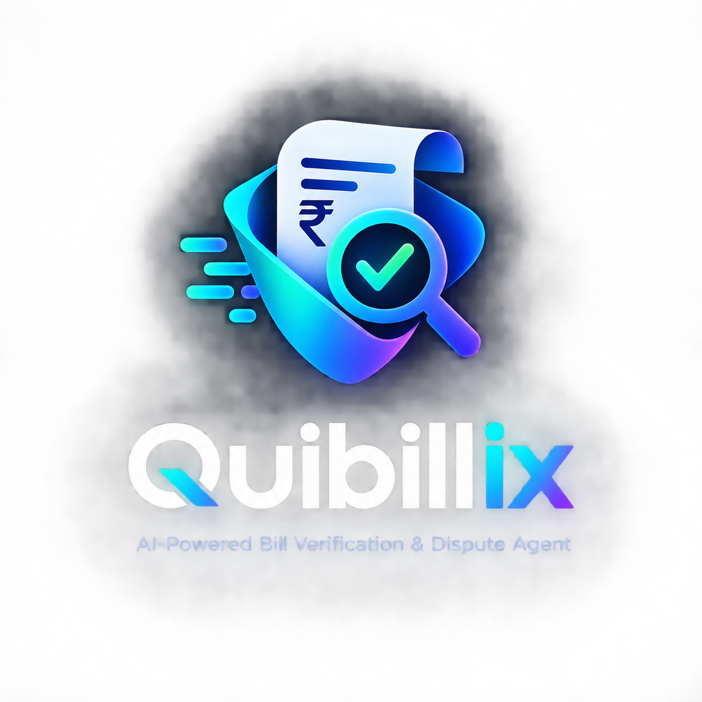

# Quibillix

<p align="center"></p>

**AI-Powered Bill Verification & Dispute Agent.** *Every charge questioned. Every dispute supported.*

*Quibillix* (quibble + bill + x) is an AI-powered bill verification and dispute agent.

**Quibillix turns checking a bill from hours of manual review into an agentic workflow: Check → Investigate → Build the dispute → Resolve with oversight.** Upload a photo or paste a medical, hospital, telecom or utility bill. NVIDIA Nemotron agents on **Nebius Token Factory** verify every line, investigate suspicious charges against live benchmarks and consumer law (via **Tavily**), and draft an evidence-backed dispute. You approve each item before anything goes out, then track the case through to the money you actually recover.

- **Live demo:** `<your-vercel-url>`
- **Demo video:** `<your-youtube-url>`
- **Track:** Best Apps and Agents
- **License:** MIT

## Why

Billing errors are common, but few people have the time or know-how to fight them. Itemized hospital bills use codes like `99285` and `0450` that most patients can't read, and an Explanation of Benefits rarely makes the problem clear. Most people just pay, and this hits hardest for people without a billing advocate, a lawyer or the spare hours to research fair prices. In India, families paying cashless-claim balances get bills full of "consumables", "service charges" and GST lines that they can't check. Quibillix acts as that billing advocate, and it costs a few cents in tokens per bill.

## The workflow

| Stage | What happens | Who |
| --- | --- | --- |
| **1. Check** | Reads the bill (photo → Nemotron 3.5 Super VL, text → fast Nemotron) into structured line items, then runs **deterministic checks**: quantity × price, duplicates, subtotal/total reconciliation, day counts vs. stay or billing period, tax on exempt healthcare, and junk fees. | Agent + code |
| **2. Investigate** | Nemotron Super plans targeted research, Tavily fetches fee schedules, rate caps and laws, and **Nemotron 3 Ultra** audits for upcoding, unbundling, price outliers, balance billing and services never received. Every claim cites a retrieved source; the model can't invent URLs. | Agent |
| **3. Build the dispute** | Drafts a dispute letter and phone script, one paragraph per item, worded by certainty: *errors to correct*, *charges to justify*, *records to provide*. | Agent |
| **4. Resolve with oversight** | **You approve or reject each finding**, and the letter is rewritten for exactly what you approved. Then the case is tracked (Draft → Sent → Responded → Resolved), you log the amount actually recovered, and a timestamped **audit trail** records every agent and human decision. | You |

### Suspected ≠ confirmed ≠ recovered

Quibillix never presents a guess as a fact. Every finding has a certainty:

- **Confirmed error**: provable from the bill's own numbers (arithmetic, day counts). Only deterministic code can confirm; the AI never does.
- **Suspected overcharge**: backed by benchmarks, rules or the user's account; the provider must justify or reduce it.
- **Needs info**: a request for itemization or records, with no money claimed.

The dashboard keeps these separate: **flagged → confirmed → approved & disputed → actually recovered**, plus estimated review time saved. Totals are capped per line, so overlapping findings never double count.

## How NVIDIA Nemotron and Nebius Token Factory are used

Each step goes to the cheapest Nemotron model that handles it well, all through one OpenAI-compatible Token Factory endpoint (`src/lib/llm.ts`):

| Step | Model (Token Factory ID) | Why this model |
| --- | --- | --- |
| Bill photo → JSON | `nvidia/Nemotron-3.5-Super-VL` | Reads document images, tables and small print |
| Bill text → JSON | `nvidia/NVIDIA-Nemotron-3-Nano-30B-A3B` | Fast and cheap for structured extraction |
| Research planning, letter, phone script | `nvidia/nemotron-3-super-120b-a12b` | Good writing and planning at mid cost |
| Deep audit | `nvidia/Nemotron-3-Ultra-550b-a55b` | Multi-step reasoning over codes, law and evidence |

Token Factory helped in several ways:
- **One API, four models:** moving a step to a different model is a one-line environment variable change, which let us A/B test models per step during the hackathon.
- **Fallback chain:** if a model is unavailable or returns an error, the step automatically retries on the next tier (Ultra → Super, Nano → Super). The demo keeps working during capacity hiccups.
- **JSON-mode prompts and a self-repair retry:** structured outputs stay reliable without a schema library.
- **Cost:** a full audit is about 5 model calls, and most tokens go through Nano or Super. Ultra handles only the single reasoning-heavy call.

**Other tools:** Tavily Search API (`search_depth: advanced`) supplies live, citable benchmark and legal evidence. It's deployed on Vercel. It could also run on Nebius Serverless Endpoints, since it's a single stateless Node service.

## Measured accuracy

`npm run eval` runs a ground-truth benchmark (`eval/cases.ts`): bills with **planted errors** plus a **clean bill** that must come back clean. Scoring is strict. A planted error only counts as caught if a money-bearing finding sits on the right line, with an accepted issue type and, where required, the right reason.

| Metric | Result (latest run, NVIDIA API endpoint) |
| --- | --- |
| Planted errors caught (recall) | **6 / 7 (86%)** |
| False positives on known-legit lines | **0** |
| Clean bill | **0 findings** ✔ |
| Avg. time per bill | ~56 s (vs. an estimated 30–60 min of manual line-by-line review) |

The miss is honest: when a utility bill used an *estimated* meter reading but the user reported an actual one, Quibillix flagged the tariff but didn't recompute usage from the actual reading. That's next on the list.

On the three demo samples (US ER visit, Indian hospital stay, telecom bill), it catches the duplicate X-ray, upcoded ER level, No Surprises Act balance billing, ICU charge with no ICU stay, extra room-days, GST on exempt healthcare, cramming add-ons and junk fees.

## Run it locally

Requirements: Node.js 20+ and a Nebius Token Factory API key. A Tavily key is optional but recommended.

```bash
git clone <this-repo-url> quibillix
cd quibillix
npm install
cp .env.example .env.local      # then fill in NEBIUS_API_KEY and TAVILY_API_KEY
npm run check-models            # verifies the Nemotron model IDs on your account
npm run dev                     # http://localhost:3000
npm run eval                    # optional: accuracy benchmark
npm run e2e -- us-er            # optional: full pipeline from the CLI (us-er | in-hospital | telecom | path/to/photo.png)
```

Click a sample bill (US ER visit, Indian hospital stay, telecom bill), then **Audit my bill**. You can also upload a photo of a real bill.

If `check-models` shows a model as `MISSING`, copy the matching NVIDIA ID from its output into `.env.local` (for example `MODEL_DEEP=...`).

### Deploy (Vercel)

1. Import the repo in Vercel.
2. Add `NEBIUS_API_KEY`, `TAVILY_API_KEY` (and optionally the `MODEL_*` variables) under Project → Settings → Environment Variables.
3. Deploy. The `/api/audit` route streams NDJSON and sets `maxDuration = 300`.

`GET /api/audit` returns which keys are configured and the model routing, which is useful for a health check.

## Architecture

```
Browser (Next.js 16, React 19, Tailwind)
   │  POST /api/audit  { text | imageDataUrl, context }      ← image is downscaled client-side
   ▼
/api/audit  ── streams NDJSON events ──►  live pipeline UI
   │
   ├─ extract   → Token Factory: Nemotron Super VL (image) / Nano (text)
   ├─ rules     → deterministic TypeScript checks (src/lib/rules.ts)  → CONFIRMED findings
   ├─ triage    → Token Factory: Nemotron Super  → search queries
   ├─ research  → Tavily Search (parallel)
   ├─ audit     → Token Factory: Nemotron Ultra (fallback: Super) → SUSPECTED / NEEDS-INFO findings + citations
   └─ letter    → Token Factory: Nemotron Super  → dispute letter + phone script
   ▼
Human review (approve/reject each finding) ── POST /api/letter ──► letter rewritten for approved items only
   ▼
Case tracker (browser localStorage): status · recovered amount · audit trail · value dashboard
```

Key files: `src/lib/pipeline.ts` (orchestrator and prompts), `src/lib/llm.ts` (Token Factory client and model routing), `src/lib/rules.ts`, `src/lib/tavily.ts`, `src/lib/cases.ts` (case tracker), `src/components/*`, `eval/` (benchmark).

**Privacy:** Quibillix has no database. Each bill is processed in memory and sent only to the model API (Nebius Token Factory). Tavily receives only the generated search queries, never the bill itself. Tracked cases live only in your browser's local storage.

## Feedback on Nebius Token Factory and NVIDIA Nemotron

See [`SUBMISSION.md`](./SUBMISSION.md#feedback).

## Disclaimer

Quibillix gives informational analysis, not legal, medical or financial advice. Check its findings with your provider or insurer.
